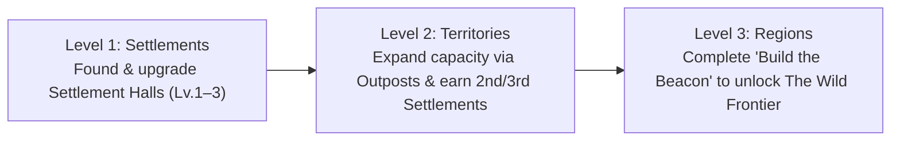

# WIF WORLDS: Game Mechanics & Civilization Progression Specification

**Status:** Locked for Phase B Smart Contract Implementation  
**Target Chain:** Robinhood Chain (`Chain ID 4663`)  
**Action Token:** `$WIF` (`0x5173b8ea6923c2d40267890d45c46a3480954773`, 18 decimals)  

---

## 1. Design Philosophy

WIF WORLDS evolves from a single-tile land claim map into a **persistent multiplayer civilization strategy game** structured around three principles:

1. **Every structure unlocks a capability:** No decorative-only sinks. Every `$WIF` building expands territory capacity, unlocks higher-tier structures, or enables additional settlements.
2. **Strategic progression over wallet size:** An unprogressed wallet with large `$WIF` holdings cannot buy out the map. Territory capacity and additional settlement slots must be earned step-by-step through development milestones.
3. **Permanent progress without punitive decay:** Settlements, structures, and claimed tiles never decay or vanish if a player steps away for days. Players return because new world briefings, neighbor expansions, and regional milestones create fresh strategic opportunities.

---

## 2. Three-Tier World Hierarchy & Addressing

### 2.1 Region-Aware Coordinate Model

Rather than hardcoding 49 tiles forever, the world is organized into **Regions**, each containing a deterministic `7 × 7` grid (`49` tiles):

- `regionId`: `uint8` (`0` = *The Heartlands*, `1` = *The Wild Frontier*, `2+` = future regions)
- `localTileId`: `uint8` (`0..48`), where `row = localTileId / 7` and `col = localTileId % 7`
- `worldTileId`: `uint16 = uint16(regionId) * 49 + uint16(localTileId)`



### 2.2 Initial Regions for MVP Release

| Region ID | Name | Grid Tiles (`worldTileId`) | Initial State | Unlock Rule |
|---|---|---|---|---|
| `0` | **The Heartlands** | `0 .. 48` | **Unlocked at Genesis** | Open to all builders immediately |
| `1` | **The Wild Frontier** | `49 .. 97` | **Locked at Genesis** | Automatically unlocked onchain when Event #1 (*Build the Beacon*) reaches 100% target `$WIF` |
| `2` | **The Highlands** | `98 .. 146` | Reserved | Enabled via future regional milestone |
| `3` | **The Crossroads** | `147 .. 195` | Reserved | Enabled via future community infrastructure event |

---

## 3. Territory Capacity & Anti-Whale Pacing

Players cannot buy unlimited tiles immediately. Each wallet has a dynamic **Territory Capacity** computed directly from its onchain buildings:

$$\text{MaxClaimableTiles}(p) = 3 + (3 \times \text{SettlementCount}) + (2 \times \text{TotalSettlementUpgrades}) + (2 \times \text{OutpostCount})$$

- **Starting Builder (`0` Settlements, `0` Outposts):** Can claim up to **3 tiles** — enough to establish a starting foothold, found a first Settlement, and place a frontier Outpost.
- **Developing Builder (`1` Settlement Lv.2 + `1` Outpost):** Capacity grows to $3 + 3 + 2 + 2 = 10$ tiles.
- **Hard Region Fairness:** `claimTile(worldTileId)` reverts if `player.tilesClaimed >= getMaxClaimableTiles(player)`.

---

## 4. Multi-Settlement Expansion Rules

Players can own **multiple Settlements** across the world (up to **3 per region**), gated by verifiable development milestones:

| Settlement Slot | Cost (`$WIF`) | Required Milestones (Enforced Onchain) | Placement Rule |
|---|---|---|---|
| **1st Settlement** | `25 $WIF` | Own target claimable tile (`settlementLevel == 0`) | Any owned claimable tile |
| **2nd Settlement** | `43.75 $WIF` | • At least **1 Settlement Hall at Level 2+**<br/>• At least **2 structures** built<br/>• At least **3 tiles** claimed | Owned claimable tile; **Manhattan distance $\ge 2$** from player's other settlements in the same region |
| **3rd Settlement** | `62.5 $WIF` | • At least **1 Settlement Hall at Level 3**<br/>• At least **4 structures** built<br/>• At least **1 World Event contribution** | Owned claimable tile; **Manhattan distance $\ge 2$** from player's other settlements in the same region |

*Spacing Rule:* Requiring Manhattan distance $|r_1 - r_2| + |c_1 - c_2| \ge 2$ between a player's own settlements prevents clumping and encourages true geographic expansion into new corners and regions.

---

## 5. Building Categories, Upgrades & Terrain Rules

Every tile stores:
- `settlementLevel`: `0` (None), `1` (Settlement Hall), `2` (Stronghold Hall), `3` (Citadel Hall)
- `structureType`: `0` (None), `1` (Outpost), `2` (Workshop), `3` (Signal Beacon)

### 5.1 Settlement Hall & Upgrades

| Tier | Name | Cost (`$WIF`) | Prerequisites | Strategic Effect |
|---|---|---|---|---|
| **Lv. 1** | **Settlement Hall** | `25` / `43.75` / `62.5` | Owned claimable tile + slot milestone | Establishes permanent settlement; `+3` Territory Capacity; unlocks regional `Workshop` construction |
| **Lv. 2** | **Stronghold Hall** | `31.25 $WIF` | Tile has `Lv. 1` Hall + player owns $\ge 2$ tiles & $\ge 1$ structure | `+2` Territory Capacity; unlocks `Signal Beacon` construction; satisfies 2nd Settlement Hall requirement |
| **Lv. 3** | **Citadel Hall** | `50 $WIF` | Tile has `Lv. 2` Hall + player owns $\ge 1$ `Workshop` | `+2` Territory Capacity; satisfies 3rd Settlement Hall requirement; top regional citadel tier |

### 5.2 Specialized Structures

| Structure | Cost (`$WIF`) | Valid Terrain | Prerequisites | Strategic Effect |
|---|---|---|---|---|
| **Outpost** (`1`) | `12.5 $WIF` | `Plains`, `Forest`, `Hills`, `Rocky` | Owned tile, `structureType == 0` (no Settlement Hall required on tile) | Frontier foothold; grants **+2 Territory Capacity**; counts toward Hall Lv.2 & expansion milestones |
| **Workshop** (`2`) | `18.75 $WIF` | `Plains`, `Forest`, `Hills` *(not sheer `Rocky`)* | Owned tile, `structureType == 0`, player has $\ge 1$ Settlement in that region | Industrial hub; unlocks **Citadel Hall (Lv. 3)** upgrades |
| **Signal Beacon** (`3`) | `31.25 $WIF` | `Hills`, `Rocky`, or any tile with `Hall Lv.2+` | Owned tile, `structureType == 0`, player has $\ge 1$ **Stronghold Hall (Lv. 2+)** | Connects settlement network to Regional Objectives; boosts regional Builder Influence |

---

## 6. Five-Stage Personal Progression Path

Each player's current stage (`1..5`) is derived deterministically from their verified contract state:

1. **Stage 1 — Found Your First Settlement:** Claim an eligible tile in *The Heartlands* (6.25 $WIF) and establish your first Settlement Hall (`Lv. 1`, 25 $WIF).
2. **Stage 2 — Develop Your Settlement:** Construct an `Outpost` or `Workshop` and upgrade your first hall to a **Stronghold Hall (`Lv. 2`)**.
3. **Stage 3 — Expand Your Territory:** Reach 3+ claimed tiles and 2+ structures to found your **2nd Settlement** in a new strategic sector.
4. **Stage 4 — Connect Your Regional Network:** Upgrade to a **Citadel Hall (`Lv. 3`)**, construct a `Signal Beacon`, and contribute `$WIF` to the active World Objective.
5. **Stage 5 — Discover New Regions:** Expand into **Region 1: The Wild Frontier** once the community completes *Build the Beacon*.

---

## 7. World Event Loop & Multiplayer Interaction

### 7.1 Event #1: Build the Beacon (Regional Unlock Trigger)
- **Location:** Northern Spire (`regionId = 0`, `localTileId = 3`, coordinates `(3, 0)`).
- **Mechanic:** Any wallet can call `contributeToEvent(1, amount)` with `$WIF` (`amount > 0`).
- **Onchain Completion Consequence:** When `totalContributed >= targetAmount`:
  1. `events[1].completed = true`
  2. Northern Spire `(3, 0)` enters illuminated monument state.
  3. **`regionUnlocked[1] = true`** — **The Wild Frontier** (`worldTileId` `49..97`) immediately unlocks onchain for all players to explore, claim, and settle!
  4. Emits `EventCompleted(1, totalContributed)` and `RegionUnlocked(1)`.

### 7.2 World Briefing & Verified Activity Feed
- **World Briefing:** Displays current active region status, active community objective progress, and exact world state consequence upon completion.
- **Verified Activity Feed:** Derived strictly from `TileClaimed`, `SettlementBuilt`, `SettlementUpgraded`, `StructureBuilt`, `EventContribution`, and `RegionUnlocked` contract events with Blockscout transaction links.
- **Regional Influence:** Tracks each builder's verified constructions and `$WIF` objective contributions per region without ranking wallets by idle token holdings.

---

## 8. Exact Smart Contract Changes (`WIFWorlds.sol` — Phase B Blueprint)

### 8.1 Compact Storage Structs

```solidity
struct Tile {
    uint16 worldTileId;     // regionId * 49 + localTileId
    uint8 regionId;         // 0 = Heartlands, 1 = Wild Frontier
    uint8 terrain;          // 0:Plains, 1:Forest, 2:Hills, 3:Water, 4:Rocky, 5:Landmark
    address owner;          // address(0) if neutral
    uint8 settlementLevel;  // 0:None, 1:Hall, 2:Stronghold, 3:Citadel
    uint8 structureType;    // 0:None, 1:Outpost, 2:Workshop, 3:Beacon
    uint32 claimedAt;
}

struct PlayerState {
    uint16 tilesClaimed;
    uint16 settlementsBuilt;
    uint16 totalSettlementUpgrades;
    uint16 structuresBuilt;
    uint16 outpostsBuilt;
    uint16 workshopsBuilt;
    uint16 beaconsBuilt;
    uint16 eventsContributed;
    uint8 maxSettlementLevel;
    uint256 totalEventWifContributed;
}

struct WorldEvent {
    string title;
    uint16 targetWorldTileId;
    uint8 unlocksRegionId;  // e.g., 1 (The Wild Frontier), or 255 if none
    uint256 targetAmount;
    uint256 totalContributed;
    uint64 deadline;        // 0 if open-ended until target met
    bool completed;
    bool active;
}
```

### 8.2 Write Functions
- `claimTile(uint256 worldTileId)`
- `buildSettlement(uint256 worldTileId)`
- `upgradeSettlement(uint256 worldTileId)`
- `buildStructure(uint256 worldTileId, uint8 structureType)`
- `contributeToEvent(uint256 eventId, uint256 amount)`

### 8.3 Single-Call Read Functions for Frontend
- `getRegionMap(uint8 regionId) external view returns (Tile[49] memory)`
- `isRegionUnlocked(uint8 regionId) external view returns (bool)`
- `getPlayerState(address player) external view returns (PlayerState memory)`
- `getMaxClaimableTiles(address player) external view returns (uint256)`
- `getSettlementCostForPlayer(address player) external view returns (uint256)`
- `getEvent(uint256 eventId) external view returns (WorldEvent memory)`

---

## 9. Telemetry & Loop Validation Metrics (Derived Onchain)

To evaluate whether retention mechanics work without relying on offchain tracking databases:
- **Repeat Builders:** Wallets with `tilesClaimed + settlementsBuilt + structuresBuilt >= 2`.
- **Multi-Settlement Architects:** Wallets that unlock and establish a 2nd or 3rd Settlement.
- **Cross-Region Pioneers:** Wallets claiming or settling in Region 1 (*The Wild Frontier*) after Beacon completion.
- **Shared Objective Participation:** Unique contributor count on `EventContribution` logs vs. single-wallet concentration.

