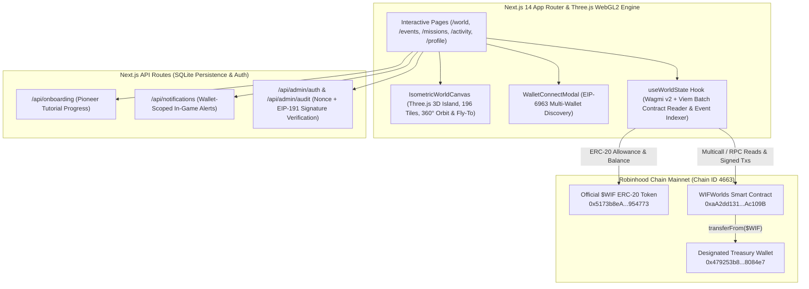

<p align="center">
  
</p>

# WIF WORLDS: The Living Map

> **A persistent, multiplayer onchain strategy and civilization-building game deployed on Robinhood Chain (`Chain ID 4663`) and powered by the official `$WIF` token (`0x5173b8eA6923c2d40267890D45C46a3480954773`).**

In **WIF WORLDS**, every land claim, settlement foundation, hall upgrade, resource production structure, harvest cycle, and community world event is verifiable onchain. Players explore a 360° interactive WebGL2 3D isometric archipelago spanning **4 regions (196 tiles)**, cultivate in-game materials (`Wood`, `Stone`, `Food`), and collaborate on sequential **$WIF World Events** that permanently unlock new territories for the entire realm.

---

## Live Production Deployments

| Service | Live URL | Description |
|---|---|---|
| **Vercel Production** | [https://wif-world.vercel.app](https://wif-world.vercel.app) | Primary global edge production deployment |
| **Railway Production** | [https://wif-world-production.up.railway.app](https://wif-world-production.up.railway.app) | High-availability containerized production deployment |
| **Robinhood Chain Explorer** | [https://robinhoodchain.blockscout.com/address/0xaA2dd131f596249755cCcdcC48447C1434Ac109B](https://robinhoodchain.blockscout.com/address/0xaA2dd131f596249755cCcdcC48447C1434Ac109B) | Live onchain `WIFWorlds` smart contract |
| **Official $WIF Token** | [https://robinhoodchain.blockscout.com/token/0x5173b8eA6923c2d40267890D45C46a3480954773](https://robinhoodchain.blockscout.com/token/0x5173b8eA6923c2d40267890D45C46a3480954773) | Hackathon ERC-20 token on Robinhood Chain |

---

## Table of Contents

1. [Live Production Deployments](#live-production-deployments)
2. [For Hackathon Judges: Step-by-Step Evaluation Guide](#for-hackathon-judges-step-by-step-evaluation-guide)
3. [Live Onchain Deployment & Verified Transactions](#live-onchain-deployment--verified-transactions)
4. [System Architecture](#system-architecture)
5. [Core Gameplay Mechanics & Onchain Economy](#core-gameplay-mechanics--onchain-economy)
6. [Smart Contract Specification (WIFWorlds.sol)](#smart-contract-specification-wifworldssol)
7. [Local Development & Testing](#local-development--testing)
8. [Community Standards, Security & License](#community-standards-security--license)

---

## For Hackathon Judges: Step-by-Step Evaluation Guide

We designed **WIF WORLDS** so judges can immediately inspect, verify, and test every system—both **read-only (without spending `$WIF`)** and **live onchain (with a connected EVM wallet on Robinhood Chain)**.

Live test instances are available at:
- **Vercel:** [https://wif-world.vercel.app](https://wif-world.vercel.app)
- **Railway:** [https://wif-world-production.up.railway.app](https://wif-world-production.up.railway.app)

### 1. Instant Read-Only Inspection (Zero Wallet Setup Required)

Even before connecting a wallet, the application streams live state directly from the `WIFWorlds` smart contract (`0xaA2dd131f596249755cCcdcC48447C1434Ac109B`) on Robinhood Chain:

- **Explore the 3D Living Map (`/world`):**
  - **Orbit & Pan:** Drag to pan across the island; hold `Shift + Drag` or `Right-Click + Drag` to orbit 360° around the archipelago; scroll or pinch to zoom.
  - **Double-Click Fly-To-Tile:** Double-click any tile on the 3D island to smoothly fly the camera directly to that territory and inspect its terrain, coordinates, owner, and structures.
  - **Inspect Claimed Pioneer Territory:** Click **Tile `(4, 3)` (Tile ID `#31`)** in *Region 0: The Heartlands* to inspect a live onchain claimed territory owned by pioneer `0x78b7b043921EE70806c66905E31fc2D9E75455a6`, or click **"Visit Realm"** in the Regional Leaderboard to enter *Inspect Another Builder's Realm Mode*.
- **Verify Sequential Onchain World Events (`/events`):**
  - View the 5 onchain-configured community milestones (*The Great Bridge*, *The Mountain Pass*, *The Grand Aqueduct*, *The Citadel Spire*, and *The World Wonder*).
  - Observe **Event #1: The Great Bridge**, which already reflects verified onchain `$WIF` progress (`6.25 $WIF`) automatically credited from pioneer land claims.
- **Inspect Verified Onchain Activity (`/activity`):**
  - View the live event log indexer that queries `TileClaimed`, `SettlementBuilt`, `SettlementUpgraded`, `StructureBuilt`, `ResourcesHarvested`, `EventContribution`, and `RegionUnlocked` logs directly from Robinhood Chain RPC with direct **Blockscout transaction links**.

### 2. Connecting a Wallet (Multi-Wallet EIP-6963 Auto-Discovery)

1. Click **Connect Wallet** in the top navigation bar.
2. Our **EIP-6963 Multi-Wallet Discovery Modal** automatically detects all installed EVM browser wallets (MetaMask, Rabby, Coinbase Wallet, OKX Wallet, Brave, Rainbow, Phantom, Trust Wallet) along with their native browser icons.
3. If your wallet is on another network, click the **Switch to Robinhood Chain (`4663`)** prompt—the app automatically configures the Robinhood Chain RPC (`https://rpc.mainnet.chain.robinhood.com`) and Blockscout explorer in your wallet.

### 3. Guided 7-Step Pioneer Onboarding Tutorial

- Click the **Tutorial** button in the top region bar on `/world` (or connect a fresh wallet) to launch the interactive **7-Step Pioneer Onboarding Modal**:
  1. *Welcome to the Archipelago*
  2. *EVM Wallet & Robinhood Chain Verification*
  3. *Civilization Mechanics & Terrain Specialization*
  4. *Selecting an Unclaimed Starting Location*
  5. *Claiming Land & Establishing a Settlement with `$WIF`*
  6. *Constructing Resource Production Buildings (`Wood`, `Stone`, `Food`)*
  7. *Completing Onchain Pioneer Missions*

### 4. Testing Live Onchain Gameplay Actions (With `$WIF` on Robinhood Chain)

If evaluating with a wallet funded with small amounts of ETH (for gas on Robinhood Chain) and `$WIF`:

1. **Claim a Neutral Tile (`6.25 $WIF`):**
   - Select any unclaimed non-water, non-landmark tile in *The Heartlands* and click **Claim Territory**.
   - First-time players automatically receive base hourly cultivation rates (`+10 Wood/h`, `+5 Stone/h`, `+10 Food/h`), and **100% of the `$WIF` spent automatically advances the active World Event onchain**.
2. **Cultivate & Harvest Materials (`harvestResources()`):**
   - Watch your **Total Materials** (`Wood`, `Stone`, `Food`) accumulate in real time in the top resource ticker and sidebar cards.
   - Click **Harvest to Vault** to execute `harvestResources()` onchain (`0 $WIF` cost, gas only), permanently banking accrued field yields into your settlement vault.
3. **Establish a Settlement & Construct Buildings:**
   - On any tile you own, open the **Build & Upgrade Modal** to found a **Settlement** (`25 $WIF`), upgrade your Settlement Hall from **Lv. 1 (Hamlet)** to **Lv. 5 (Sovereign Capital)**, or construct **Lumber Camps**, **Quarries**, **Farms**, **Workshops**, **Outposts**, and **Signal Beacons**.
4. **Contribute to Community World Events (`/events`):**
   - Contribute `$WIF` directly to the active World Event. When `currentAmount >= targetAmount`, the smart contract automatically marks the event completed, unlocks the target region onchain (`isRegionUnlocked[regionId] = true`), and activates the next World Event in sequence (`1 -> 2 -> 3 -> 4 -> 5`).

### 5. Evaluating Security & Private Treasury Administration (`/admin`)

- The **Admin Dashboard (`/admin`)** is strictly private to the designated Treasury & Administrator wallet (`0x479253b82Eb63eb36F140EcABf0237cc338084e7`).
- **For Ordinary Wallets / Unconnected Visitors:** The `Admin` navigation link is completely hidden, and navigating directly to `/admin` enforces an access-denied guard with zero leakage of administrative controls.
- **Cryptographic Session Security:** Server-side admin APIs (`/api/admin/auth`, `/api/admin/audit`) enforce **nonce-bound EIP-191 wallet signature verification** (`viem.verifyMessage`) bound to an `HttpOnly` session cookie, plus smart-contract-level `onlyAdmin` modifiers.

---

## Live Onchain Deployment & Verified Transactions

All smart contracts and economy parameters are live on **Robinhood Chain Mainnet (`4663`)**:

| Parameter | Value | Blockscout Explorer Link |
|---|---|---|
| **Network Name** | Robinhood Chain | Chain ID `4663` (`0x1237`) |
| **JSON-RPC Endpoint** | `https://rpc.mainnet.chain.robinhood.com` | Live Mainnet RPC |
| **Block Explorer** | Blockscout | [https://robinhoodchain.blockscout.com](https://robinhoodchain.blockscout.com) |
| **`WIFWorlds` Game Contract** | `0xaA2dd131f596249755cCcdcC48447C1434Ac109B` | [View Contract on Blockscout](https://robinhoodchain.blockscout.com/address/0xaA2dd131f596249755cCcdcC48447C1434Ac109B) |
| **Official `$WIF` Token** | `0x5173b8eA6923c2d40267890D45C46a3480954773` | [View `$WIF` Token](https://robinhoodchain.blockscout.com/token/0x5173b8eA6923c2d40267890D45C46a3480954773) |
| **Treasury & Admin Wallet** | `0x479253b82Eb63eb36F140EcABf0237cc338084e7` | [View Treasury Wallet](https://robinhoodchain.blockscout.com/address/0x479253b82Eb63eb36F140EcABf0237cc3380954773) |

### Key Verified Onchain Transactions

| Action | Transaction Hash | Blockscout Link |
|---|---|---|
| **`WIFWorlds` Contract Deployment (4 Maps • 196 Tiles • 5 Events)** | `0xf48366cf80a028a7e4af3c28230aceda787da19a5bda5e32713226ea5f20ea65` | [Inspect Tx](https://robinhoodchain.blockscout.com/tx/0xf48366cf80a028a7e4af3c28230aceda787da19a5bda5e32713226ea5f20ea65) |
| **Official `$WIF` Token Approval (`approve`)** | `0xab6e44d34f00b86693018242cedf63fcf6761c47f05d2c3cbfcee781681357d8` | [Inspect Tx](https://robinhoodchain.blockscout.com/tx/0xab6e44d34f00b86693018242cedf63fcf6761c47f05d2c3cbfcee781681357d8) |
| **Onchain Resource Harvest (`harvestResources`)** | `0xeca0f9c1c534ad3b99834d692ab135a1397e074b79a19e74ae10dacfee8eaece` | [Inspect Tx](https://robinhoodchain.blockscout.com/tx/0xeca0f9c1c534ad3b99834d692ab135a1397e074b79a19e74ae10dacfee8eaece) |
| **Pioneer Tile #31 Claim (`claimTile`)** | `0x5e8a32d3d68f765eb010b259cf4db558f8d49ed63e096d4ae323ab116cd0111d` | [Inspect Tx](https://robinhoodchain.blockscout.com/tx/0x5e8a32d3d68f765eb010b259cf4db558f8d49ed63e096d4ae323ab116cd0111d) |

---

## System Architecture



### Repository Structure

```text
wif-worlds/
├── app/                        # Next.js 14 App Router pages & API endpoints
│   ├── activity/               # Live Onchain World Activity Feed (/activity)
│   ├── admin/                  # Private Treasury Owner Dashboard (/admin)
│   ├── api/                    # Server-side endpoints (onboarding, notifications, admin auth)
│   ├── events/                 # 5 Sequential Onchain Community World Events (/events)
│   ├── missions/               # Onchain-verified Pioneer Missions (/missions)
│   ├── profile/                # Player & Public Builder Profiles (/profile, /profile/[address])
│   ├── rules/                  # Comprehensive Game Codex & Economy Rules (/rules)
│   ├── world/                  # Primary 3D Isometric World Map & HUD (/world)
│   └── page.tsx                # Gamified Landing Page with Live World Telemetry
├── components/                 # Modular React & Three.js UI components
│   ├── build/                  # BuildActionModal ($WIF + Resource validation & tx stepper)
│   ├── layout/                 # TopNavbar, WalletConnectModal (EIP-6963), PageTransition
│   ├── notifications/          # Wallet-isolated NotificationCenter dropdown
│   ├── onboarding/             # 7-step interactive OnboardingModal
│   ├── profile/                # PlayerProfileView & civilization badges
│   └── world/                  # IsometricWorldCanvas (Three.js WebGL2) & MobileLandscapeGuard
├── contracts/                  # Foundry Smart Contract Suite
│   ├── src/WIFWorlds.sol       # Core WIFWorlds multiplayer civilization contract
│   ├── test/WIFWorlds.t.sol    # Comprehensive Foundry unit & integration test suite
│   ├── script/Deploy.s.sol     # Deployment & onchain initialization script
│   └── WIFWorlds.flattened.sol # Flattened contract source for Blockscout verification
├── lib/                        # Core blockchain & game logic libraries
│   ├── chain/robinhood.ts      # Robinhood Chain (4663) definition & EIP-55 address sanitizer
│   ├── contract/               # Contract ABI & useWorldState Wagmi/Viem hooks
│   ├── game/worldData.ts       # Deterministic 4-region terrain generator & formulas
│   └── server/                 # SQLite store & cryptographic admin session verification
├── CODE_OF_CONDUCT.md          # Contributor Covenant Code of Conduct
├── CONTRIBUTING.md             # Developer & Smart Contract Contribution Guidelines
├── LICENSE                     # MIT License
└── SECURITY.md                 # Smart Contract & Application Security Policy
```

---

## Core Gameplay Mechanics & Onchain Economy

### 1. Three-Tier Spatial Hierarchy (4 Regions • 196 Onchain Tiles)
- **Region 0 — The Heartlands (Tiles `0–48`):** Unlocked at genesis. Lush plains, forests, and river crossings around the Ancient Obelisk.
- **Region 1 — The Wild Frontier (Tiles `49–97`):** Unlocked permanently when Community Event #1 (*The Great Bridge*) reaches 100%.
- **Region 2 — The Highlands (Tiles `98–146`):** Alpine ridges and rich stone quarries unlocked by Community Event #2 (*The Mountain Pass*).
- **Region 3 — The Crossroads (Tiles `147–195`):** Central trade basin unlocked by Community Event #3 (*The Grand Aqueduct*).

### 2. Anti-Whale Territory Capacity Formula
No single wallet can buy out the entire map at once. Maximum claimable tiles scale strictly with real civilization development:

$$\text{MaxClaimableTiles} = 3 + (3 \times \text{Settlements}) + (2 \times \text{Upgrades}) + (2 \times \text{Outposts})$$

### 3. Settlement Progression (Levels 1 to 5) & Adjacency Rules
- Each player can establish up to **3 Settlements** per region (`1st: 25 $WIF`, `2nd: 43.75 $WIF`, `3rd: 62.5 $WIF`).
- **Minimum Distance Rule:** A player's settlements within the same region must be at least **Manhattan distance $\ge 3$** apart (`|r1 - r2| + |c1 - c2| >= 3`), preventing cluster-spamming.
- **5 Upgrade Tiers:**
  - **Lv. 1 Hamlet:** Base foundation (`+5/h Wood, +3/h Stone, +5/h Food`, `+200 Vault Cap`)
  - **Lv. 2 Village:** `10 $WIF` + `50 Wood, 30 Stone, 40 Food`
  - **Lv. 3 Town:** `15 $WIF` + `100 Wood, 80 Stone, 80 Food`
  - **Lv. 4 Stronghold:** `22.5 $WIF` + `180 Wood, 150 Stone, 140 Food`
  - **Lv. 5 Sovereign Capital:** `30 $WIF` + `280 Wood, 250 Stone, 220 Food`

### 4. Resource Cultivation & Terrain Specialization
Every claimed tile can host one specialized structure:
- **Lumber Camp (`5 $WIF` + `20 Food`):** `+15 Wood/h` (**`+25 Wood/h`** on **Forest** tiles)
- **Quarry (`5 $WIF` + `25 Wood, 15 Food`):** `+12 Stone/h` (**`+22 Stone/h`** on **Rocky/Hills** tiles)
- **Farm (`5 $WIF` + `20 Wood`):** `+15 Food/h` (**`+25 Food/h`** on **Plains** tiles)
- **Outpost (`7.5 $WIF` + `40 Wood, 25 Stone`):** Expands territory claim capacity by `+2 tiles`
- **Workshop (`10 $WIF` + `60 Wood, 60 Stone`):** Expands resource vault storage capacity by `+150 units` and `+4 Wood/h, +4 Stone/h`
- **Signal Beacon (`15 $WIF` + `80 Wood, 100 Stone, 60 Food`):** High-prestige landmark (`+6/h` all resources, `+35 Activity Score`)

---

## Smart Contract Specification (WIFWorlds.sol)

Located at [`contracts/src/WIFWorlds.sol`](./contracts/src/WIFWorlds.sol), compiled with Solidity `0.8.24`:

- **Core Write Functions:**
  - `claimTile(uint256 worldTileId)` — Claims an unowned tile in an unlocked region, charges `$WIF` to the Treasury, initializes base production rates, and credits the active World Event.
  - `harvestResources()` — Syncs elapsed cultivation time (`block.timestamp - lastResourceSync`) and banks `Wood`, `Stone`, and `Food` into the player's vault up to `getResourceStorageCap(player)`.
  - `buildSettlement(uint256 worldTileId)` — Establishes a Lv. 1 Settlement on a claimed tile after verifying regional slot limits and Manhattan distance $\ge 3$.
  - `upgradeSettlement(uint256 worldTileId)` — Upgrades a Settlement from Lv. 1 up to Lv. 5 using both `$WIF` and banked `Wood`/`Stone`/`Food`.
  - `buildStructure(uint256 worldTileId, uint8 structureType)` — Constructs an Outpost, Workshop, Signal Beacon, Lumber Camp, Quarry, or Farm with terrain bonus calculation.
  - `contributeToEvent(uint256 eventId, uint256 amount)` — Contributes `$WIF` directly to a community World Event and triggers auto-unlocking of the next region and event upon completion.
- **Core Read Functions:**
  - `getRegionMap(uint8 regionId)` — Returns all 49 `Tile` structs for a region (`0..3`) in a single RPC call.
  - `getPlayerState(address player)` — Returns full player telemetry, building counts, stored resources, and hourly production rates.
  - `getPendingResources(address player)` — Computes real-time accrued `Wood`, `Stone`, `Food`, and `storageCap`.

---

## Local Development & Testing

### Prerequisites
- **Node.js** `>= 18.x` and **npm**
- **Foundry (`forge`)** (optional, for running Solidity smart contract tests)

### 1. Clone & Install Dependencies

```bash
git clone https://github.com/OpeyemiMoses/WIF-WORLD.git
cd WIF-WORLD
cp .env.example .env.local
npm install
```

### 2. Run the Development Server

```bash
npm run dev
```

Open [http://localhost:3000](http://localhost:3000) in your browser. All Robinhood Chain Mainnet contract addresses and RPC endpoints are pre-configured in `.env.example` and `lib/chain/robinhood.ts`.

### 3. Run Smart Contract Tests (Foundry)

```bash
cd contracts
forge test -vvv
```

### 4. Production Build Verification

```bash
npx tsc --noEmit
npm run build
```

---

## Community Standards, Security & License

We maintain full GitHub Community Standards for open-source transparency and security:

- **[Contributing Guidelines (CONTRIBUTING.md)](./CONTRIBUTING.md)** — How to propose features, run checks, and submit pull requests.
- **[Code of Conduct (CODE_OF_CONDUCT.md)](./CODE_OF_CONDUCT.md)** — Contributor Covenant v2.1 standards for our community.
- **[Security Policy (SECURITY.md)](./SECURITY.md)** — Smart contract safety guarantees, admin authentication architecture, and vulnerability reporting.
- **[MIT License (LICENSE)](./LICENSE)** — Open-source licensing terms.

---

## Disclaimer

*WIF WORLDS is an independent project created for the World is Flat Hackathon and is not affiliated with, endorsed by, or officially connected with Robinhood Markets, Inc.*
